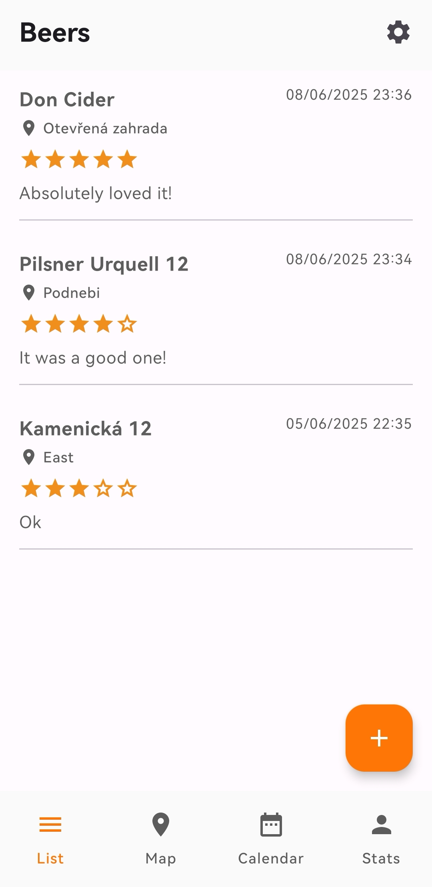
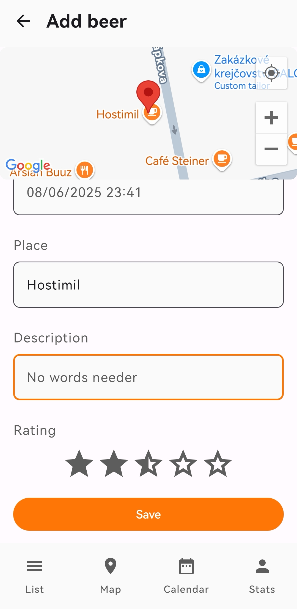
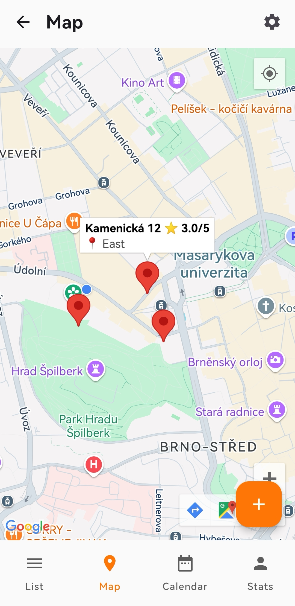
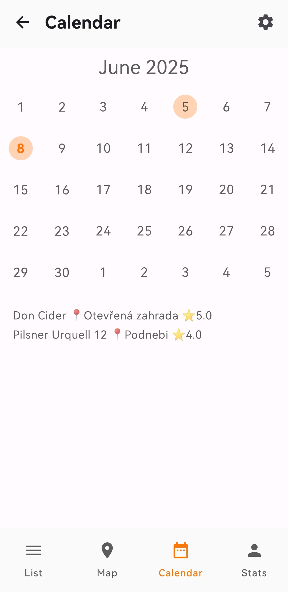
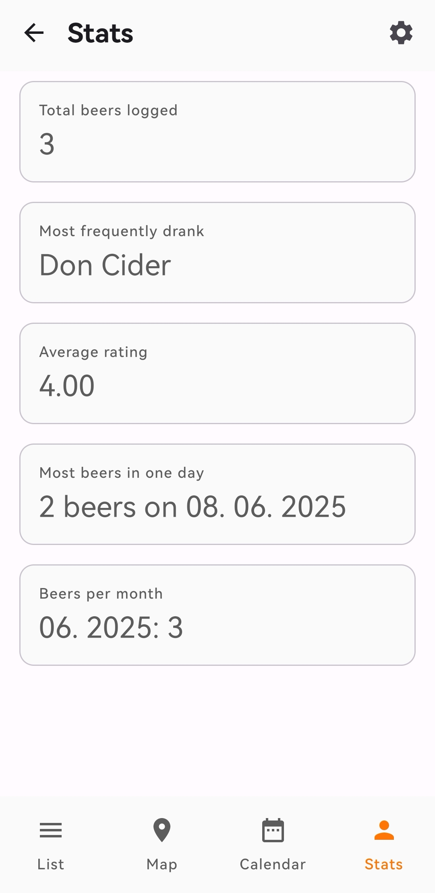

# BeerMap

A native Android app designed to help users track and document their beer tasting experiences. Built with modern Android development practices, this app allows users to log beers, rate them, and see their tasting history on a map or in a calendar overview.

## Features

* **Detailed Logging:** Add new beer entries with specific details including the place, timestamp, personal description, and a 5-star rating[cite: 11].
* **Interactive Map:** Browse all your saved tasting locations across the city using an integrated Google Map[cite: 12].
* **Calendar View:** Easily navigate through your tasting history using a monthly calendar component that highlights days with logged entries[cite: 13].
* **Personal Statistics:** Track your drinking habits with automated stats, including your total beers logged, most frequently drank beer, average rating, and a monthly breakdown[cite: 9].
* **Organized List:** View a chronological feed of all your beer logs with locations and ratings at a glance[cite: 10].

## Screenshots

  
  
  
  
  

## Tech Stack & Architecture

* **Platform:** Native Android (Kotlin)
* **UI Framework:** Jetpack Compose with Material Design 3 components
* **Architecture:** MVVM (Model-View-ViewModel)
* **Local Storage:** Room Database for local persistence of logs and statistics
* **Integrations:** Google Maps SDK for Android
* **Dependency Injection:** Hilt (Dagger)
